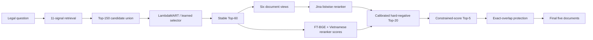
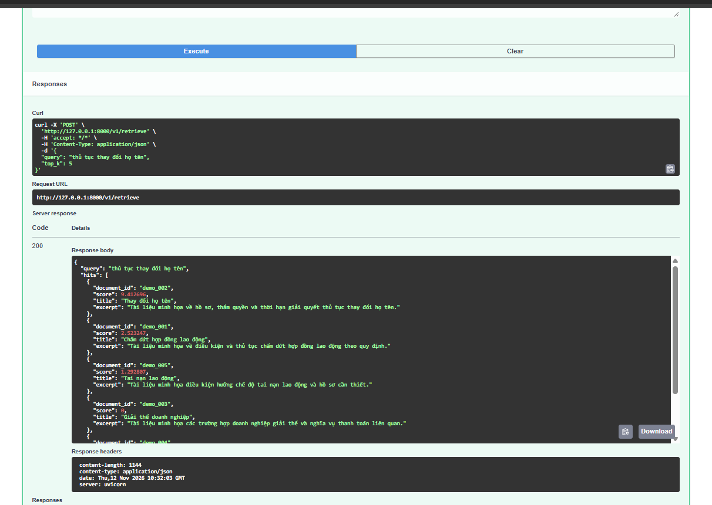

# LegalIR — High-Recall Vietnamese Legal Retrieval

An evidence-driven personal project for Vietnamese legal information
retrieval. The system combines sparse retrieval,
multiple dense retrievers, legal-domain embeddings, learning-to-rank, six-view
listwise reranking, calibrated hard-negative mining, and conservative Top-5
decision policies.

> **Verified private benchmark score: 0.9428**
> Evaluation set: 2,080 private questions
> Offline audit set: 512 questions / 712 relevant documents

This public repository is primarily a technical case study of the **full
research pipeline**, reconstructed from its source, manifests and audit
reports. FastAPI is only an auxiliary serving demo. The repository
intentionally excludes restricted questions and labels, model weights,
large caches, API keys and submission files.

For the complete data-to-submission walkthrough, read
**[docs/full_pipeline.md](docs/full_pipeline.md)**. Any upstream detail that
cannot yet be proven is explicitly listed in
[docs/source_gaps.md](docs/source_gaps.md), rather than guessed.

## What is reproduced publicly?

The public API is a **small deployment demo**, not the full research model.
The full architecture and verified metrics are documented accurately, but the
restricted data, trained weights, and derived caches cannot be redistributed.

| Component | Full research system | Public runnable demo |
|---|---|---|
| Data | Private legal corpus and 2,080 private queries | 8 synthetic Vietnamese legal documents |
| Candidate retrieval | 11-signal weighted RRF, Top-150 | Lightweight BM25 |
| Learned ranking | LambdaMART Top-60/20/5 | Not included in demo inference |
| Transformer reranking | Jina six-view scoring | Not included in demo inference |
| Shared implementation | RRF, constrained Top-5, metrics, validation | Included and unit-tested |
| Serving | Original batch/cache pipeline | FastAPI and Docker interface demo only |
| Claimed score | Verified private benchmark `0.9428` | No benchmark score claimed |

The public service preserves the expected request/response and ranking
interfaces so an authorized user can replace the demo backend with the frozen
research artifacts without changing the API contract.

## Why this project matters

Legal retrieval is a high-recall problem with asymmetric risk: removing a
relevant legal document from the final five results can be much more costly
than failing to promote a marginal candidate. The project therefore treats
every reranking step as a constrained decision rather than blindly sorting by
one model score.

Key engineering contributions:

- fused **11 heterogeneous retrieval signals** into a Top-150 candidate pool;
- built a two-stage learning-to-rank funnel from Top-150 to Top-60 and Top-20;
- scored Top-60 candidates with **Jina reranker in six document views**;
- improved Recall@5 while preserving candidate membership at Top-20/30/60;
- used nested out-of-fold audits, bootstrap intervals, weighted recall, and
  per-fold guardrails to reject attractive but unsafe experiments;
- implemented resumable SQLite scoring and three-machine sharding for
  748,800 query-view-document scores;
- archived deterministic manifests and SHA-256 checksums for reproducibility.

## Results

### Verified offline funnel

| Stage | Hits | Recall | Weighted recall | Zero-hit queries |
|---|---:|---:|---:|---:|
| Stable Top-5 | 466 / 712 | 0.6545 | 0.9481 | 92 |
| Stable Top-20 | 613 / 712 | 0.8610 | 0.9861 | 25 |
| Hard-negative Top-20 | 616 / 712 | 0.8652 | 0.9865 | 25 |
| Constrained-score Top-5 | **475 / 712** | **0.6671** | **0.9503** | **86** |
| Final Top-60 candidate coverage | 686 / 712 | 0.9635 | 0.9965 | 5 |

The strongest verified Top-5 policy recovered **9 additional relevant
documents** over the stable ranking while preserving Top-20, Top-30, and
Top-60 membership.

### Private evaluation

| Submission | Status | Score |
|---|---|---:|
| Stable constrained-score + exact-overlap protection | Verified private benchmark | **0.9428** |
| V5 strict cross-fit + exact-overlap protection | Experimental; generated after final audit | Not claimed |
| Native V15 consensus + LambdaMART + exact protection | High-risk experiment | Not claimed |

Only the `0.9428` result is presented as a verified private-benchmark result. The
experimental variants are documented because their negative audits were as
important as the winning components.

## End-to-end architecture



The real pipeline begins before retrieval: a clean fine-tuning subset is
rendered into one-positive/seven-hard-negative tuples shared by three dense
encoders. The 11 signals, their fold-safe construction, both LambdaMART
stages, Jina scoring and the final protection rule are documented in the
[full pipeline walkthrough](docs/full_pipeline.md).

### Retrieval signals

The candidate generator used complementary lexical, dense, domain-specific,
fine-tuned, direct-retrieval, and graph signals. Weighted reciprocal-rank
fusion used the frozen configuration:

```text
RRF k = 3
weights = [1.500, 0.668, 0.632, 0.501, 0.093,
           0.747, 0.299, 0.186, 0.620, 0.443, 0.317]
limits  = [30, 50, 30, 50, 50, 100, 100, 50, 20, 50, 100]
```

### Six-view reranking

Each candidate document was represented by six independently selected views:

1. lexical section 1;
2. lexical section 2;
3. lexical section 3;
4. dense segment 1;
5. dense segment 2;
6. dense segment 3.

The scoring workload contained:

```text
2,080 queries × 60 documents × 6 views = 748,800 scores
```

Scores and materialized passages were checkpointed in SQLite. The workload
was split into 694/693/693-query shards and executed on three GPUs, then
merged with row-count, query-count, call-count, and SHA-256 validation.

### Conservative Top-5 policy

The best verified policy does not replace the whole ranking. It:

1. freezes the calibrated hard-negative Top-20 universe;
2. lets a score router select five documents only inside that universe;
3. accepts a policy only when Top-20/30/60 invariants remain unchanged;
4. evaluates raw recall, weighted recall, zero-hit queries, fold deltas, and
   bootstrap uncertainty before deployment.

## Validation methodology

The audit design was intentionally stricter than a single validation score:

- fixed five-fold split;
- nested out-of-fold policy selection;
- query-level bootstrap confidence intervals;
- raw and difficulty-weighted Recall@5;
- per-fold non-regression checks;
- explicit gained/lost relevant-document cases;
- frozen Top-20/30/60 membership assertions;
- label-free private inference;
- exact artifact identity via SHA-256.

See [docs/experiments.md](docs/experiments.md) for the full ablation history.

## Repository layout

```text
.
├── configs/
│   └── pipeline_public.yaml
├── docs/
│   ├── architecture.md
│   ├── experiments.md
│   ├── full_pipeline.md
│   ├── reproducibility.md
│   ├── source_gaps.md
│   └── resume_bullets.md
├── src/
│   └── legalir_portfolio/
├── tests/
├── .gitignore
├── CITATION.cff
├── LICENSE
└── requirements.txt
```

## Reproducibility boundary

The complete private archive contained 538 artifacts and 4.64 GB before
compression. It included model-independent scores, SQLite caches, reports,
frozen policies, source snapshots, manifests, and final submissions. That
archive remains private because it contains restricted benchmark data.

The public repository supports:

- code review of ranking, gate, audit, and deployment logic;
- replay against user-provided data with matching schemas;
- verification of the methodology and reported public-safe metrics.

It does **not** redistribute the restricted dataset or private labels.

## Local setup

```bash
python -m venv .venv
source .venv/bin/activate
pip install -r requirements.txt
```

The original full pipeline was developed with Python 3.12, LightGBM,
scikit-learn, PyTorch, Transformers, NumPy, and SQLite. GPU inference used
mixed precision and Flash Attention where supported.

## Run the deployment demo

The public demo uses a small synthetic Vietnamese legal corpus; it does not
contain restricted data and it is not used to justify the reported score.
Its purpose is only to show an inspectable REST contract, validation,
packaging and deployment boundary around a retrieval service.

```bash
pip install -r requirements-api.txt
PYTHONPATH=src uvicorn legalir_api.app:app --reload
```

Windows Command Prompt (`cmd.exe`):

```bat
python -m pip install -r requirements-api.txt
set "PYTHONPATH=%CD%\src"
python -m uvicorn legalir_api.app:app --reload
```

Windows PowerShell:

```powershell
python -m pip install -r requirements-api.txt
$env:PYTHONPATH="$PWD\src"
python -m uvicorn legalir_api.app:app --reload
```

Open Swagger UI at <http://127.0.0.1:8000/docs>, then call:

```bash
curl -X POST http://127.0.0.1:8000/v1/retrieve \
  -H "Content-Type: application/json" \
  -d '{"query":"thủ tục thay đổi họ tên","top_k":5}'
```

Docker deployment:

```bash
docker compose up --build
```

Available endpoints:

- `GET /health`
- `GET /metrics`
- `POST /v1/retrieve`
- `POST /v1/fuse`

### API demo

The screenshot below shows a successful Vietnamese legal query returning five
ranked documents through the public FastAPI demo.



The VSOL AI Engineer requirement mapping and interview pitch are documented in
[docs/vsol_application.md](docs/vsol_application.md).

For a concise explanation of the project, use the
[interview guide](docs/interview_guide.md). The public demo intentionally has
only eight synthetic documents so every component is easy to inspect and
explain; it is not a disguised sample of the private benchmark dataset.

## What I learned

- A raw improvement can hide severe weighted-recall regressions.
- Candidate generation and final selection must be audited separately.
- Conservative abstention often beats a more expressive but unstable gate.
- Resumability and artifact identity are first-class ML system features.
- Negative experiments are valuable when they prevent an unsafe deployment.

## Data and model licensing

This repository contains only original orchestration/audit code and sanitized
configuration. External datasets and pretrained models remain subject to their
respective licenses. No restricted benchmark data is included.
