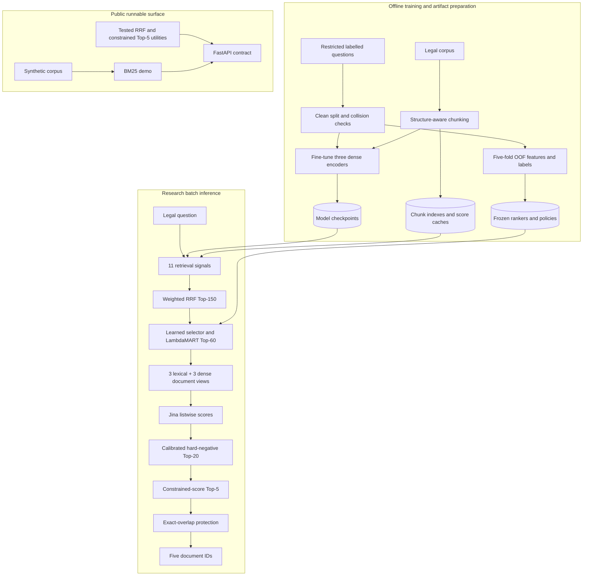

# Vietnamese Legal Retrieval

A personal information-retrieval project for finding relevant Vietnamese legal
documents from natural-language questions. The research system was designed as
a high-recall funnel: heterogeneous retrieval creates a broad candidate set,
learning-to-rank narrows it, multi-view reranking scores long documents, and a
constrained final policy selects five results without changing the protected
candidate universe.

The restricted benchmark data, trained weights, score caches, and submissions
cannot be published. This repository therefore separates two things:

- an **evidence-backed case study** of the research pipeline and its aggregate
  out-of-fold results;
- a **small runnable demo** with eight synthetic documents, plus tested RRF,
  constrained-selection, metric, and submission-validation utilities.

It does not present the BM25 demo as the system that produced the reported
research results.

## Results

The main audit used five-fold out-of-fold evaluation on **512 questions and
712 relevant question-document pairs**.

| Stage | Hits | Recall | Weighted recall | Zero-hit queries |
|---|---:|---:|---:|---:|
| Stable Top-5 | 466 / 712 | 0.6545 | 0.9481 | 92 |
| Stable Top-20 | 613 / 712 | 0.8610 | 0.9861 | 25 |
| Hard-negative Top-20 | 616 / 712 | 0.8652 | 0.9865 | 25 |
| Constrained-score Top-5 | **475 / 712** | **0.6671** | **0.9503** | **86** |
| Stable Top-60 coverage | 686 / 712 | 0.9635 | 0.9965 | 5 |

The constrained Top-5 policy improved the stable ranking by **9 relevant
documents**. A query-level bootstrap comparison reported a 95% interval of
`[1, 18]` hits and `P(delta > 0) = 0.9775`. Top-20, Top-30, and Top-60
membership remained unchanged by the final Top-5 selection.

A final private submission recorded a **0.9428 leaderboard score**. This is
reported as a competition outcome, not as a publicly reproducible benchmark:
the evaluator and labels are unavailable in this repository.

Aggregate metrics and hashes of the private source reports are recorded in
[`artifacts/cal512_metrics.json`](artifacts/cal512_metrics.json). No restricted
query text, document text, IDs, labels, or predictions are included.

## System overview



The full research path ran as reproducible batch jobs with cached intermediate
artifacts; FastAPI is only a deployment-interface demonstration.

## Engineering decisions

| Decision | Why | Guardrail / trade-off |
|---|---|---|
| Fuse 11 lexical, dense, memory, prior, and graph rankings | Maximize candidate recall before expensive scoring | Fixed per-signal depths prevent weak tails from dominating |
| Weighted RRF to Top-150 | Combine ranks without assuming comparable score scales | Weights and depths were frozen before final evaluation |
| Two learned ranking stages | Spend model capacity near Top-60 and Top-20 boundaries | Cross-fitted features avoid training on in-sample selections |
| Six views per long document | Relevant provisions may be far from a document prefix | 3 lexical sections + 3 query-conditioned dense windows increase compute |
| SQLite passage/score cache | GPU reranking was long-running and failure-prone | Resume, shard, merge, row-count, and hash validation |
| Constrain final Top-5 to Hard Top-20 | Improve precision without losing protected coverage | Reject policies that regress weighted recall or outer folds |
| Exact-match protection only | Reuse labels when normalized questions are identical | Semantic-neighbor transfer was audited but not treated as equivalent |

## Evaluation design

- fixed five-fold out-of-fold evaluation;
- raw and difficulty-weighted Recall@5;
- zero-hit query count;
- gained/lost relevant-document cases;
- query-level bootstrap intervals;
- protected Top-20/30/60 membership checks;
- SHA-256 identity and expected-row checks for cached artifacts;
- no private labels used during private inference.

See [`docs/experiments.md`](docs/experiments.md) for ablations and rejected
ideas. Negative experiments are included because raw hit gains sometimes hid
large weighted-recall losses.

## Run the public demo

Python 3.10+ is required.

```bash
python -m venv .venv
source .venv/bin/activate             # Windows: .venv\Scripts\activate
python -m pip install -e ".[api,test]"
pytest -q
```

Start the API:

```bash
python -m uvicorn legalir_api.app:app --reload
```

Open <http://127.0.0.1:8000/docs> or call:

```bash
curl -X POST http://127.0.0.1:8000/v1/retrieve \
  -H "Content-Type: application/json" \
  -d '{"query":"thủ tục thay đổi họ tên","top_k":5}'
```

The demo returns synthetic documents only. Docker is optional:

```bash
docker compose up --build
```


## Repository map

```text
artifacts/                  sanitized aggregate metrics and provenance hashes
configs/                    public-safe research configuration
data/                       eight-document synthetic demo corpus
docs/                       architecture, experiments, pipeline, limitations
src/legalir_portfolio/      RRF, constrained Top-5, metrics, validation
src/legalir_api/            synthetic BM25/FastAPI demo
tests/                      unit and smoke tests
```

## Reproducibility boundary

Publicly runnable:

- RRF and constrained Top-5 logic;
- ranking metrics and membership checks;
- submission validation;
- synthetic BM25 API demo and Docker image;
- tests and aggregate provenance validation.

Documented but not fully runnable without authorized private artifacts:

- data preparation and encoder fine-tuning;
- all 11 retrieval caches;
- LightGBM selector/ranker training;
- Jina six-view scoring;
- full private inference and submission generation.

The exact boundary and required private inputs are listed in
[`docs/reproducibility.md`](docs/reproducibility.md). The one unresolved
upstream transformation is documented in
[`docs/source_gaps.md`](docs/source_gaps.md), rather than guessed.

## Documentation

- [Architecture](docs/architecture.md)
- [Full pipeline walkthrough](docs/full_pipeline.md)
- [Experiments and ablations](docs/experiments.md)
- [Reproducibility and data governance](docs/reproducibility.md)
- [Portfolio audit report](docs/audit_report.md)
- [Interview guide](docs/interview_guide.md)

## License and data policy

Original code and documentation in this repository are released under the
[MIT License](LICENSE). External datasets and pretrained models retain their
own licenses. Restricted benchmark data, derived private caches, model weights,
credentials, and submissions are intentionally excluded.
