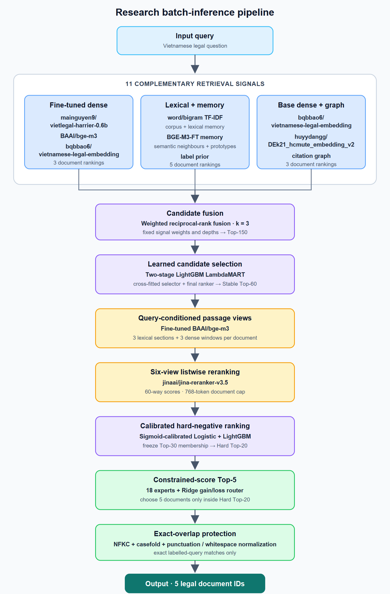

# Vietnamese Legal Retrieval

Multi-stage information retrieval for mapping Vietnamese legal questions to at
most five relevant legal documents. The research pipeline combines eleven
lexical, dense, memory, prior, and graph signals with learning-to-rank and
six-view listwise reranking.

[](pyproject.toml)
[](https://github.com/ducdanh2304/vietnamese-legal-retrieval/actions/workflows/tests.yml)
[](LICENSE)

## Results at a glance

Five-fold out-of-fold evaluation on **CAL512: 512 questions / 712 relevant
question-document pairs**.

| Pipeline checkpoint | Relevant hits | Recall | Weighted recall | Zero-hit queries |
|---|---:|---:|---:|---:|
| Stable Top-5 | 466 / 712 | 0.6545 | 0.9481 | 92 |
| Stable Top-20 | 613 / 712 | 0.8610 | 0.9861 | 25 |
| Calibrated hard-negative Top-20 | 616 / 712 | 0.8652 | 0.9865 | 25 |
| **Constrained-score Top-5** | **475 / 712** | **0.6671** | **0.9503** | **86** |
| Stable Top-60 coverage | 686 / 712 | 0.9635 | 0.9965 | 5 |

The final Top-5 policy recovered **9 additional relevant documents** over the
stable Top-5 while preserving Top-20/30/60 membership. Its query bootstrap
reported a 95% hit-delta interval of `[1, 18]` and `P(delta > 0) = 0.9775`.

A private submission recorded a **0.9428 leaderboard score** on 2,080
questions. This is a competition outcome, not a publicly reproducible
benchmark; the evaluator and private labels are not distributed.

## System architecture

<picture>
  <source srcset="docs/assets/inference-pipeline.svg" type="image/svg+xml">
  
</picture>

Editable source: [`docs/diagrams/inference-pipeline.mmd`](docs/diagrams/inference-pipeline.mmd).

| Stage | Model / method | Purpose |
|---|---|---|
| Candidate retrieval | Fine-tuned `mainguyen9/vietlegal-harrier-0.6b`, `BAAI/bge-m3`, `bqbbao6/vietnamese-legal-embedding`; TF-IDF memory/corpus; `huyydangg/DEk21_hcmute_embedding_v2`; label/prototype/graph signals | Build complementary document rankings |
| Fusion | Weighted reciprocal-rank fusion, `k=3` | Merge 11 rankings into Top-150 without calibrating incompatible score scales |
| Learned selection | Two-stage LightGBM LambdaMART | Select and reorder the stable Top-60 |
| Passage scoring | FT BGE-M3 view selection + `jinaai/jina-reranker-v3.5` | Score 3 lexical sections and 3 dense windows per document |
| Hard boundary | Sigmoid-calibrated logistic/LightGBM ranking | Improve Top-20 while freezing Top-30/60 membership |
| Final selection | 18 experts + Ridge gain/loss router | Choose five documents only inside Hard Top-20 |
| Protection | Exact normalized-query match | Protect known relevant documents only for exact matches |

The figure shows research **batch inference**, not the synthetic FastAPI demo.
Training, hard-negative construction, checkpoint, embedding, and index lineage
are shown separately in [the architecture document](docs/architecture.md).

## Key engineering decisions

| Decision | Why it was chosen | Evidence / trade-off |
|---|---|---|
| Fuse heterogeneous rankings before learned reranking | Lexical, dense, memory, and graph methods fail differently | Stable Top-60 retained 686/712 relevant documents |
| Use legal-structure-aware chunks | Relevant provisions may sit deep inside long legal documents | 596,062 chunks preserve document IDs and section context; higher storage cost |
| Score six query-conditioned views | A single prefix can miss the answering article | 3 lexical + 3 FT BGE-M3 windows; 6× reranking workload |
| Cross-fit learned stages | Prevent selector decisions from becoming in-sample ranker features | Fixed five-fold OOF audit; more models and artifacts to manage |
| Constrain Top-5 to Hard Top-20 | Improve precision without destroying candidate coverage | Top-5 466→475 while Top-20/30/60 membership stayed fixed |
| Cache passages and scores in SQLite | Reranking 748,800 private query-view-document rows must survive interruption | Resume/shard/merge checks; additional artifact governance |

## Quick start

The public repository contains tested ranking utilities and an eight-document
**synthetic BM25 API demo**. It does not contain the restricted data, trained
checkpoints, or caches required to reproduce the research metrics.

```bash
git clone https://github.com/ducdanh2304/vietnamese-legal-retrieval.git
cd vietnamese-legal-retrieval
python -m venv .venv
source .venv/bin/activate                 # Windows: .venv\Scripts\activate
python -m pip install -e ".[api,test]"
pytest -q
python -m uvicorn legalir_api.app:app --reload
```

Open <http://127.0.0.1:8000/docs> and run `POST /v1/retrieve`, or use Docker:

```bash
docker compose up --build
```

The reusable public package implements weighted RRF, constrained Top-5,
ranking metrics, membership invariants, and submission validation. See
[reproducibility](docs/reproducibility.md) for the authorized-artifact boundary.

## Repository structure

```text
artifacts/              sanitized metrics and source-report hashes
configs/                public-safe frozen research configuration
data/                   synthetic API corpus
docs/                   architecture, experiments, pipeline, limitations
src/legalir_portfolio/  RRF, constrained selection, metrics, validation
src/legalir_api/        BM25/FastAPI demo
tests/                  unit and smoke tests
```

## Documentation

- [Architecture and training artifacts](docs/architecture.md)
- [Full pipeline walkthrough](docs/full_pipeline.md)
- [Experiments and ablations](docs/experiments.md)
- [Reproducibility and data governance](docs/reproducibility.md)
- [Known source gap](docs/source_gaps.md)
- [Portfolio audit report](docs/audit_report.md)

## Limitations

- The full research path cannot run from this public repository alone.
- CAL512 is a small internal audit split; bootstrap uncertainty and fold-level
  regressions still matter.
- Exact-match protection is intentionally narrow; semantic label transfer was
  not treated as ground truth.
- The public API demonstrates an interface and packaging boundary, not the
  measured 11-signal system.

## Model references and license

- [`mainguyen9/vietlegal-harrier-0.6b`](https://huggingface.co/mainguyen9/vietlegal-harrier-0.6b)
- [`BAAI/bge-m3`](https://huggingface.co/BAAI/bge-m3)
- [`bqbbao6/vietnamese-legal-embedding`](https://huggingface.co/bqbbao6/vietnamese-legal-embedding)
- [`huyydangg/DEk21_hcmute_embedding_v2`](https://huggingface.co/huyydangg/DEk21_hcmute_embedding_v2)
- [`AITeamVN/Vietnamese_Reranker`](https://huggingface.co/AITeamVN/Vietnamese_Reranker)
- [`jinaai/jina-reranker-v3.5`](https://huggingface.co/jinaai/jina-reranker-v3.5)

Original code and documentation are released under the [MIT License](LICENSE).
External datasets and pretrained models retain their own licenses. Restricted
benchmark data, private caches, model weights, credentials, and submissions are
intentionally excluded.
