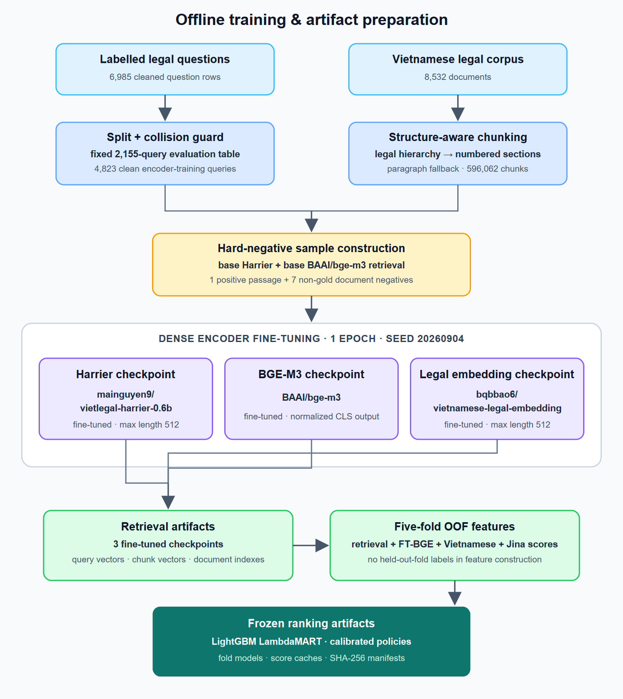

# LexViet architecture and artifact lineage

The repository separates offline model preparation from research batch
inference. The FastAPI application is a synthetic BM25 interface demo and does
not appear in either research diagram.

## Training and artifact preparation

<picture>
  <source srcset="assets/training-artifacts.svg" type="image/svg+xml">
  
</picture>

The editable source is
[`diagrams/training-artifacts.mmd`](diagrams/training-artifacts.mmd). The
rendered SVG has a fixed light background so labels remain readable on GitHub's
light and dark themes.

### Data preparation

1. Start from 6,985 cleaned labelled questions and 8,532 legal documents.
2. Hold out the fixed 2,155-question evaluation table.
3. Remove seven normalized exact-question collisions, leaving 4,823 queries
   for encoder fine-tuning.
4. Chunk the corpus by legal hierarchy, numbered sections, then paragraph
   fallback. Dense text receives document/section context; lexical text does
   not receive synthetic headers.
5. Mine seven non-gold documents per query from base Harrier and base BGE-M3
   retrieval; choose one positive passage from a labelled document.

### Model and artifact table

| Artifact | Base model / method | Verified output |
|---|---|---|
| Harrier checkpoint | `mainguyen9/vietlegal-harrier-0.6b` | Fine-tuned dense encoder, max length 512 |
| BGE-M3 checkpoint | `BAAI/bge-m3` | Fine-tuned normalized CLS dense encoder |
| Legal embedding checkpoint | `bqbbao6/vietnamese-legal-embedding` | Fine-tuned dense encoder, max length 512 |
| Corpus representation | Structure-aware chunker | 596,062 chunks aligned to parent document IDs |
| Learned selectors | LightGBM LambdaMART | Five OOF models plus full-fit selector/ranker |
| Reranker cache | `jinaai/jina-reranker-v3.5` | Six query-document view scores in SQLite |
| Auxiliary score cache | `AITeamVN/Vietnamese_Reranker` | Full-document, section, and dense-window score features |

All three encoder fine-tuning runs used the same positive/negative document
choices, one epoch, and seed `20260904`. Model IDs above are taken from the
preserved source/configuration; the fine-tuned checkpoints were private local
artifacts, not newly published Hugging Face model IDs.

## Inference pipeline

The README contains the compact vertical overview. Its editable source is
[`diagrams/inference-pipeline.mmd`](diagrams/inference-pipeline.mmd) and the
rendered asset is [`assets/inference-pipeline.svg`](assets/inference-pipeline.svg).

### Retrieval signal legend

The overview groups eleven rankings into three readable branches:

| Group | Signals |
|---|---|
| Fine-tuned dense | `harrier_ft`, `bge_ft`, `legal_embedding_ft` |
| Lexical and labelled memory | `lexical_memory`, `semantic_memory`, `corpus_lexical`, `bge_prototype`, `label_prior` |
| Base dense and graph | `legal_dense`, `dek21_direct`, `citation_graph` |

`dek21_direct` used `huyydangg/DEk21_hcmute_embedding_v2` at preserved revision
`99a2963b2f51fa7a570a3e7f550d7993b9de90a8`. Label-dependent memory, prototype,
and prior features were constructed out of fold for CAL512.

### Ranking spine

1. **Weighted RRF:** merge the eleven rankings with `k=3`, frozen signal
   weights, and per-signal depth limits; retain Top-150.
2. **Stable Top-60:** a cross-fitted candidate selector uses native and
   boundary features; a second LambdaMART ranker learns only from cross-fitted
   selections.
3. **Six views:** fine-tuned BGE-M3 selects three lexical sections and three
   dense windows for each candidate.
4. **Jina reranking:** `jinaai/jina-reranker-v3.5` scores each 60-document list
   independently for all six views with a 768-token document cap.
5. **Hard Top-20:** sigmoid-calibrated logistic and regularized LightGBM scores
   blend with stable-rank evidence while Top-30 membership stays frozen.
6. **Constrained Top-5:** twelve native score experts and six Jina-view experts
   feed Ridge gain/loss heads; five documents are selected only from Hard
   Top-20.
7. **Exact protection:** a deterministic normalized exact-query match may
   protect known relevant documents. Semantic similarity alone is not accepted
   as identity.

## Stored-artifact contract

Long-running stages exchange immutable artifacts instead of hidden process
state. Serious outputs record their schema, upstream hash, query/row counts,
label-usage flag, and policy configuration. Passages and scores are stored
separately in SQLite so model inference can resume, shard across machines, and
merge only after count and SHA-256 validation.

## Public boundary

The repository exposes RRF, constrained Top-5, metrics, invariants, submission
validation, and a synthetic BM25 API. Rebuilding the diagrams' full research
path requires the restricted corpus/labels, checkpoints, embeddings, rankings,
feature caches, Jina SQLite, and frozen policies listed in
[reproducibility.md](reproducibility.md).
