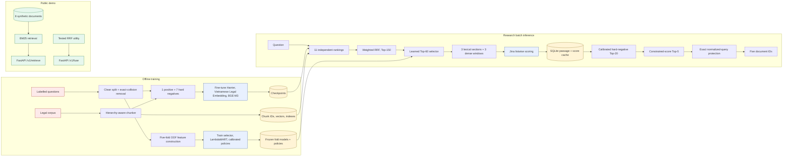

# Architecture

This document separates model development, research batch inference, stored
artifacts, and the small public API demo. Only the last path is directly
runnable from this repository without private inputs.

## Ranking funnel

1. **Candidate generation:** eleven heterogeneous rankings produce complementary
   evidence. Weighted reciprocal-rank fusion forms a Top-150 union.
2. **Top-60 selection:** a cross-fitted learned selector concentrates expensive
   scoring on candidates near the decision boundary.
3. **Multi-view scoring:** long documents are represented by three lexical
   sections and three dense query-conditioned windows.
4. **Top-20 calibration:** relevance probabilities and stable-rank evidence
   reorder only the protected Top-30 boundary.
5. **Top-5 decision:** a constrained router chooses five documents from the
   frozen Hard Top-20; deeper membership cannot change.
6. **Deterministic protection:** exact normalized matches may protect known
   relevant documents. Semantic similarity alone is insufficient.

## Artifact contract

Long-running stages exchange immutable artifacts rather than hidden process
state. Each serious output records its schema, upstream path/hash, row or query
count, label-usage flag, and policy configuration. SQLite separates materialized
passages from model scores so reranking can resume and shards can be merged with
count and hash checks.

## Public code boundary

The repository includes implementations and tests for RRF, constrained Top-5,
metrics, membership invariants, submission validation, and the synthetic API.
The private training and inference scripts are documented from preserved source
reports but are not repackaged here because their required inputs cannot be
distributed.
